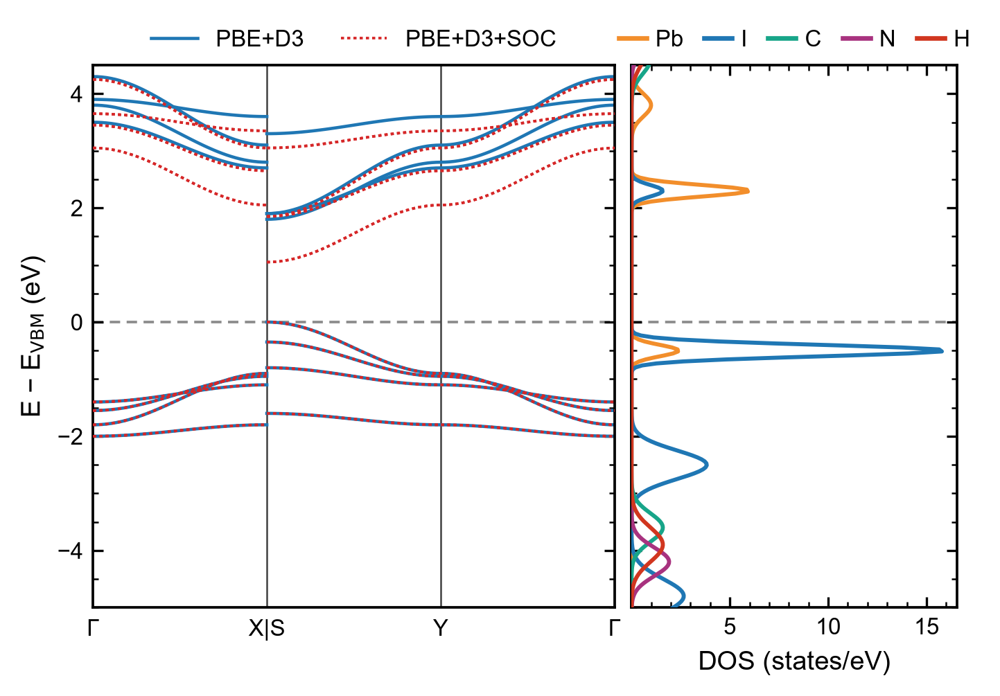

# Band structure and projected DOS

**Band structure(s) next to the element- and orbital-projected density of states, read straight from
the VASP files — with the band edges, the gap and the atomic character of the edges reported.**

<p align="center"></p>

## Why

A band structure tells you *where* in the Brillouin zone the band edges sit and whether the gap is
direct; the projected DOS tells you *which atoms and orbitals* build those edges. Read together they
answer the questions that matter for a semiconductor: is the gap direct, how dispersive (light or
heavy) are the carriers, and is the hole or the electron on the inorganic framework or on the organic
part? Overlaying a second band set — the same path without and with spin–orbit coupling, PBE against a
hybrid functional — shows at a glance what the more expensive treatment changes.

`bands_dos.py` needs only numpy and matplotlib (no pymatgen), reads collinear, spin-polarized and
non-collinear (SOC) runs, line-mode and explicit k-paths (including the zero-weight paths of
hybrid-functional band runs), and DOSCARs written with `LORBIT = 10` or `11`.

## The physics in five lines

1. Kohn–Sham eigenvalues of different calculations have no common zero, so every data set is drawn as
   **E − E_VBM of its own run** (`--ref vbm`, default). The VBM is the highest occupied state, taken from
   the occupations in EIGENVAL (or from NELECT when they are missing).
2. Along a path, `x` is the distance in reciprocal space (1/Å, from the POSCAR cell), so segments have
   their true lengths; a jump between two non-adjacent points (A → B) draws no line and is labelled **A|B**.
3. **Gap** = CBM − VBM; it is **direct** when both edges sit at the same k-point. For an indirect gap the
   script also reports the smallest direct gap.
4. The projected DOS of element X is $\sum_{i\in X}\sum_{lm} g_{i,lm}(E)$ — the sum over its atoms and the
   chosen orbitals of the DOS projected on spheres around each atom.
5. **Edge character**: the number of states of each curve in the window [VBM − w, VBM] and [CBM, CBM + w]
   (`--edge-window w`, default 1 eV) — which element makes the hole and which the electron.

## Setting up the VASP runs

Two runs on the converged charge density (`CHGCAR`) of a self-consistent calculation:

```
! band structure (non-self-consistent)        ! DOS (dense uniform mesh)
ICHARG = 11                                   ICHARG = 11
LORBIT = 11                                   LORBIT = 11      ! lm-resolved projections
ISMEAR = 0 ; SIGMA = 0.01                     ISMEAR = -5      ! tetrahedra (or 0 with small SIGMA)
NBANDS = <enough empty bands>                 NEDOS  = 3001    ! fine energy grid
```

KPOINTS of the band run in **line mode**, one label per end point (`G`, `GAMMA` or `\Gamma` all become Γ):

```
k-path
40
Line-mode
Reciprocal
  0.0 0.0 0.0  ! G
  0.5 0.0 0.0  ! X

  0.5 0.5 0.0  ! S
  0.0 0.5 0.0  ! Y
  ...
```

**Hybrid functionals** (HSE06, PBE0) cannot run non-self-consistently: the band run is a self-consistent
run whose explicit KPOINTS lists the weighted mesh *followed by the path points with weight 0*. The
script keeps only the zero-weight points and reads their labels from the 5th column (`0.5 0.0 0.0 0 X`
or `... 0 ! X`). With VASP 6, `KPOINTS_OPT` does the same job; when a `KPOINTS_OPT` is present the
script reads `EIGENVAL_OPT` instead of `EIGENVAL`.

Files read — band folder: `EIGENVAL` (or `EIGENVAL_OPT`), `KPOINTS` (or `KPOINTS_OPT`), `POSCAR`/`CONTCAR`,
`INCAR`, `OUTCAR`; DOS folder: `DOSCAR`, `POSCAR`/`CONTCAR`, `INCAR`, `OUTCAR`, `EIGENVAL`.

## Quick start with the example data

The folders below are written by [`synthetic_bands.py`](../examples/synthetic_bands.py) for a toy
lead-iodide layer (1 Pb, 4 I, 2 small methylammonium-like cations). The bands are analytic cosines with a
known answer, not a calculation: the gap is direct at S = (½, ½, 0) and equals 1.80 eV without SOC and
1.05 eV with SOC. The DOS is a sum of Gaussian peaks of known area per element (independent of the toy
bands): 4.0 I states and 0.6 Pb states in the eV below the VBM, 1.5 Pb and 0.4 I states in the eV above
the CBM.

```bash
python examples/synthetic_bands.py                  # (re)writes the example folders
python Band_Structure_DOS/bands_dos.py --bands examples/bands_nosoc examples/bands_soc \
       --dos examples/dos_lorbit11 --emin -5 --emax 4.5 --save-data
```

```
[bands 1] examples/bands_nosoc
  PBE+D3: ISPIN = 1, non-collinear = False, 120 k-points (EIGENVAL), 8 bands
  path: Γ X|S Y Γ
  VBM = -1.2000 eV at S; CBM = 0.6000 eV at S
  gap = 1.800 eV (direct); E_F(OUTCAR) = -1.1500 eV
[bands 2] examples/bands_soc
  PBE+D3+SOC: ISPIN = 1, non-collinear = True, 120 k-points (EIGENVAL), 16 bands
  path: Γ X|S Y Γ
  VBM = -1.1500 eV at S; CBM = -0.1000 eV at S
  gap = 1.050 eV (direct); E_F(OUTCAR) = -1.1000 eV
[dos] examples/dos_lorbit11
  PBE+D3: ISPIN = 1, non-collinear = False, LORBIT = 11, NEDOS = 401, dE = 35.0 meV
  energy zero = -1.2000 eV (VBM of the DOS run)
  VBM = -1.2000 eV, CBM = 0.6000 eV, gap = 1.800 eV (EIGENVAL of the DOS run)
  character of the band edges (states within 1 eV of the VBM / CBM):
    curve       VB edge  share  CB edge  share
    Pb            0.600    13%    1.500    79%
    I             4.000    87%    0.400    21%
    C             0.000     0%    0.000     0%
    N             0.000     0%    0.000     0%
    H             0.000     0%    0.000     0%
saved bands_dos.png
saved bands_dos.pdf
saved bands_dos_bands_1.csv
saved bands_dos_bands_2.csv
saved bands_dos_dos.csv
```

The hybrid-functional example uses an explicit KPOINTS (16 weighted mesh points + 60 zero-weight path
points):

```bash
python Band_Structure_DOS/bands_dos.py --bands examples/bands_hybrid --no-plot
```

```
[bands 1] examples/bands_hybrid
  HSE06+SOC: ISPIN = 1, non-collinear = True, 60 k-points (EIGENVAL), 16 bands
  path: Γ X|S Y Γ
  VBM = -1.4500 eV at S; CBM = 0.2500 eV at S
  gap = 1.700 eV (direct); E_F(OUTCAR) = -1.4000 eV
```

On a console without Unicode (e.g. a Windows pipe) Γ is printed as G.

## Step by step

1. **Spin and SOC.** `ISPIN` and `LNONCOLLINEAR` are read from the OUTCAR (the INCAR is the fallback).
   SOC runs have twice as many bands, each singly occupied; ISPIN = 2 runs carry two eigenvalue channels.
2. **Path.** The k-points of EIGENVAL are converted to Cartesian (1/Å) with the POSCAR cell. In line mode
   the labels come from KPOINTS; for explicit lists, from the label column; with no labels at all, ticks
   are placed at the kinks of the path. Zero-weight points, when present next to weighted ones, are the path.
3. **Band edges.** States with occupation > 0.5 are occupied; the VBM/CBM and their k-points follow. The
   printed location is the tick label when the edge sits on one (S here — the right side of the X|S jump).
4. **Method label.** From the INCAR: `GGA`/`METAGGA`, `LHFCALC` + `HFSCREEN`/`AEXX` (HSE06, PBE0), `IVDW`
   (D2, D3, D3(BJ), D4, TS, MBD) and `LSORBIT` (+SOC). `--names` overrides it.
5. **DOS.** The DOSCAR columns are identified from ISPIN, the non-collinear flag and their number
   (LORBIT 10: s p d [f]; LORBIT 11: s, py pz px, dxy … dx²−y² [, 7 f]). Spin-polarized columns are split
   into up and down; for non-collinear runs only the first (total) of the four components
   (total, m_x, m_y, m_z) of each orbital is used. A count that matches none of these stops the script.
6. **Energy zero.** Each band set is shifted by its own VBM, the DOS by the VBM of the EIGENVAL in the DOS
   folder (or by E_F of the DOSCAR when there is none).

## Reading the figure

| Feature | Meaning |
|---|---|
| solid blue / dotted red bands | first and second band folder (here without and with SOC), each with its own VBM at 0 |
| dashed lines inside one set | spin-down channel of an ISPIN = 2 run |
| a label `A\|B` | the path jumps from A to B; no band is drawn across the jump |
| a DOS peak with no band nearby | the DOS run covers the whole zone, the path only a few lines of it — or, as here, the DOS is an independent toy |
| SOC lowers the lowest conduction band | typical of heavy-element (Pb, Bi, Sn) conduction bands: the gap closes by several tenths of an eV |
| DOS on the negative axis | spin-down DOS of an ISPIN = 2 run |

## Options

| Option | Meaning |
|---|---|
| `--bands DIR [DIR ...]` | band folder(s); the second one is overlaid (mapped onto the path of the first) |
| `--dos DIR` | DOS folder |
| `-o NAME` | output name; `NAME.png` + `NAME.pdf`, or only the format given as suffix (`-o fig.svg`) |
| `--emin`, `--emax` | energy window (eV, default −4 … 4) |
| `--ref vbm/fermi/none` | energy zero of every data set (own VBM, E_F, raw eigenvalues) |
| `--names A B` | legend names of the band sets (default: from INCAR) |
| `--labels G X S Y G` | k labels at the ticks (use `X\|S` for a jump) when KPOINTS has none |
| `--proj Pb I:p C:sp` | DOS curves: elements or element:orbitals (default: every element) |
| `--total` | also draw the total DOS (grey) |
| `--smear 0.05` | extra Gaussian broadening of the DOS (eV) |
| `--dosmax 20` | upper limit of the DOS axis |
| `--edge-window 1.0` | window (eV) of the edge-character report |
| `--width-mm`, `--height-mm`, `--fontsize`, `--ratio`, `--dpi` | figure size, font, band/DOS panel ratio, resolution |
| `--save-data` | CSV of every curve: `NAME_bands_<i>.csv` (`x_inv_A, s1_b1, …`) and `NAME_dos.csv` (`E, total, Pb, …`) |
| `--no-plot` | report (and CSV) only |

## Good practice and pitfalls

- **Enough empty bands.** A band run with `NBANDS` too small has no conduction band; the script stops
  with "every band is occupied".
- **The band edge may be off the path.** The path samples a few lines of the zone; check that the
  VBM/CBM of the DOS run (uniform mesh) agree with those of the band run.
- **Same structure, same functional.** The DOS and the bands are referenced to their *own* VBM; overlaying
  a SOC band set on a non-SOC DOS aligns them at the VBM, not on an absolute scale (for that, see
  [`Band_Alignment_Vacuum`](../Band_Alignment_Vacuum)).
- **Projections do not add up to the total DOS.** They are computed in spheres of radius `RWIGS` around
  each atom; the interstitial charge is missing, so the sum of all elements is smaller than the total DOS.
- **Coarse DOS grid.** With the default `NEDOS = 301` peaks are poorly resolved; the script warns when
  the grid step exceeds 50 meV. Use `NEDOS = 3001` or `--smear`.
- **Hybrid band runs.** If the zero-weight points carry no occupations in EIGENVAL, the script falls back
  on `NELECT` from the OUTCAR, which is correct for an insulator but not for a metal.

## References

- VASP wiki: [Band-structure calculation](https://www.vasp.at/wiki/index.php/Band-structure_calculation_using_density-functional_theory),
  [Band structure with hybrid functionals](https://www.vasp.at/wiki/index.php/Band-structure_calculation_using_hybrid_functionals),
  [KPOINTS](https://www.vasp.at/wiki/index.php/KPOINTS), [KPOINTS_OPT](https://www.vasp.at/wiki/index.php/KPOINTS_OPT),
  [LORBIT](https://www.vasp.at/wiki/index.php/LORBIT), [DOSCAR](https://www.vasp.at/wiki/index.php/DOSCAR),
  [EIGENVAL](https://www.vasp.at/wiki/index.php/EIGENVAL).
- W. Setyawan and S. Curtarolo, *Comput. Mater. Sci.* **49**, 299 (2010) — standard high-symmetry paths.
- J. Even, L. Pedesseau, J.-M. Jancu and C. Katan, *J. Phys. Chem. Lett.* **4**, 2999 (2013) — the
  spin–orbit lowering of the conduction band of lead-halide perovskites.
