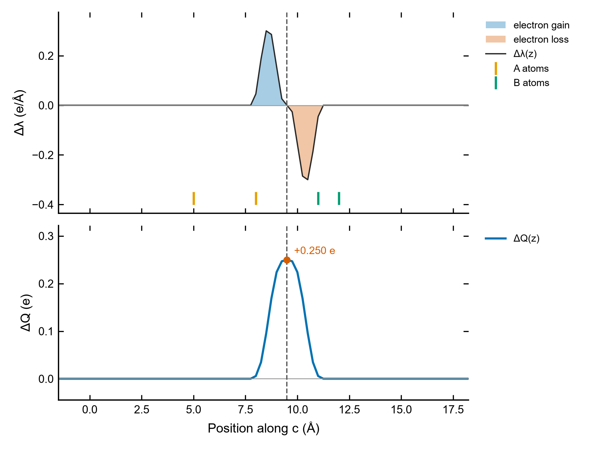

# Charge-density difference of two fragments

**Where the electrons go when two fragments A and B are put together: the 3D difference
Δρ = ρ_AB − ρ_A − ρ_B for VESTA, its plane-averaged profile and the charge-displacement curve ΔQ(z),
from three VASP CHGCARs — with the checks that make the subtraction meaningful.**

<p align="center"></p>

## Why

A molecule adsorbed on a surface, an organic layer on an inorganic one, the two sides of a
heterostructure: in every case one wants to know whether binding moves charge, how much, and
where. The density difference answers this without partitioning the density into atoms
(Bader, DDEC, ...): it is a field you can look at (isosurfaces in VESTA) and integrate over planes.

The subtraction is unforgiving. If the three densities are not on the same grid, in the same cell,
with the fragment atoms at exactly the same positions, Δρ is dominated by the mismatch and looks like
chemistry. `chgdiff.py` checks this first and says what differs.

## The physics in a few lines

1. **Density difference.** Δρ(**r**) = ρ_AB(**r**) − ρ_A(**r**) − ρ_B(**r**): positive (gain)
   where electrons accumulate on binding, negative (loss) where they are depleted.
   Its integral is N_AB − N_A − N_B = 0 for neutral fragments.
2. **Line density.** Integrate Δρ over the plane normal to z (one cell):
   Δλ(z) = ∬ Δρ dx dy, in e/Å. (The plane *average* Δρ̄(z) = Δλ(z)/A, in e/ų, is in the CSV too.)
3. **Charge-displacement curve.** ΔQ(z) = ∫_{z₀}^{z} Δλ(z′) dz′, with z₀ in the vacuum where Δρ = 0.
   At a plane between A and B, **ΔQ is the charge that crossed the plane on binding**:
   ΔQ > 0 means electrons moved towards −z (into the region below the plane).
4. **Dipole.** μ = −∫ (z − z_c) Δλ(z) dz (e·Å per cell; electrons are negative). A dipole layer shifts
   the vacuum level on the two sides by ΔV = −e μ / (ε₀ A) (top minus bottom), the change of the work
   function produced by the rearrangement.

ΔQ at one plane is a *model* of charge transfer (it depends on where the plane is), but a well-defined
one, and the whole curve shows whether the result is robust to the choice: a plateau of ΔQ between the
fragments means it is.

## Setting up the three VASP runs

Run three single points (`NSW = 0`): the whole system AB, then fragment A alone and fragment B alone,
each **with the atoms at exactly the positions they have in AB** (delete the other fragment's atoms
from the AB `CONTCAR`; do not relax the fragments).

```
LCHARG = .TRUE.          ! write CHGCAR
NGXF = 120               ! the SAME fine FFT grid in all three runs (copy NGXF/NGYF/NGZF from the AB OUTCAR)
NGYF = 120
NGZF = 400
ISYM = 0                 ! a fragment can have higher symmetry than AB: do not symmetrize the densities
```

- Keep the same cell, `ENCUT`, `PREC`, POTCARs, functional and dipole correction (`IDIPOL`/`LDIPOL`)
  in the three runs. VASP chooses the FFT grid from the cell, `ENCUT` and `PREC`, so it is usually the
  same anyway; fixing `NGXF/NGYF/NGZF` makes it certain.
- **Fragment charge and spin.** Cutting a covalent bond or separating an ion pair leaves fragments that
  are radicals or ions. Choose and state their charge (`NELECT`) and spin (`ISPIN = 2` for radicals);
  ∫Δρ = 0 only if N_A + N_B = N_AB. The script reads the total density (first block) of
  spin-polarized and non-collinear CHGCARs.
- CHGCAR holds the valence (pseudo) density; cores cancel in the difference, so this is what you want.

## Quick start with the example data

The folder [`examples/charge_difference`](../examples) holds three synthetic CHGCARs written by
[`synthetic_chgdiff.py`](../examples/synthetic_chgdiff.py): Gaussian charge blobs for fragment A
("Pb" at z = 5 Å, "I" at 8 Å) and fragment B ("N" at 11 Å, "H" at 12 Å), and
ρ_AB = ρ_A + ρ_B + a known displacement that moves **0.25 e** from the B side (z ≈ 10.4 Å) to the
A side (z ≈ 8.6 Å), entirely across the plane z = 9.5 Å. Known answer: ∫Δρ = 0, ΔQ(9.5 Å) = +0.25 e,
μ = 0.25 × 1.8 = 0.45 e·Å. (The A file is written like a spin-polarized CHGCAR, with augmentation
occupancies and a magnetization block, to show that they are skipped.)

```bash
python Charge_Density_Difference/chgdiff.py examples/charge_difference/AB/CHGCAR \
       examples/charge_difference/A/CHGCAR examples/charge_difference/B/CHGCAR \
       --plot edd.png --csv edd.csv
```

```
AB  examples/charge_difference/AB/CHGCAR: grid 8 x 8 x 80, 4 atoms
A   examples/charge_difference/A/CHGCAR: grid 8 x 8 x 80, 2 atoms
B   examples/charge_difference/B/CHGCAR: grid 8 x 8 x 80, 2 atoms
compatible: same cell and grid; AB atoms = A (2) + B (2), largest position difference 0.0e+00 Å
electrons: AB 17.0000, A 11.0000, B 6.0000
integral of drho = N_AB - N_A - N_B = +0.00000 e
difference -> CHGDIFF.vasp  (CHGCAR format: drho * V_cell, as VESTA expects)
max |drho| on the 3D grid 5.982e-02 e/Å^3 = 8.865e-03 e/bohr^3 (isosurface levels of ~5-10 % of it show the main features)
profile along c: 20.000 Å, 80 points; dQ integrated from z0 = 18.500 Å (middle of the vacuum)
max |lambda| 0.3001 e/Å, max |plane-averaged drho| 1.200e-02 e/Å^3
dQ at the end of the window +0.00000 e (= integral)
dipole of drho +0.4502 e·Å (+2.162 D) per cell -> vacuum-level step (top - bottom) -3.258 eV
mirror symmetry about the slab centre (8.500 Å): asymmetric (index 0.62; 0 = symmetric)
 plane (Å)  where                         dQ (e)
     9.500  A|B boundary                 +0.2500
dQ > 0: electrons crossed the plane towards -z (into the region below it)
profile -> edd.csv
figure -> edd.png
```

The tool recovers the 0.25 e and the 0.45 e·Å that were put in. (The vacuum-level step is large because
the toy cell is only 25 Ų in area.) A deliberately incompatible fragment is included too:

```bash
python Charge_Density_Difference/chgdiff.py examples/charge_difference/AB/CHGCAR \
       examples/charge_difference/A/CHGCAR examples/charge_difference/B_other_grid/CHGCAR
```

```
[FAIL] the three CHGCARs are not compatible:
  - grid of B is 6 x 6 x 60, AB is 8 x 8 x 80 — set the same NGXF NGYF NGZF in all three INCARs
```

## Step by step

1. **Compatibility.** The headers are read first: same grid, same cell (to 10⁻⁴ Å), and every atom of A
   and of B matched to one atom of AB with the same element within `--tol` (10⁻³ Å, minimum image).
   Every failure is listed — a moved atom with its displacement, an AB atom that belongs to no
   fragment, an atom present in both, a different element at the same place. Nothing is computed
   unless everything matches (`--allow-mismatch` turns atom mismatches into warnings; grid and cell
   mismatches are always fatal).
2. **Streaming difference.** The three files are read in lockstep, one xy slice of the grid at a time,
   and Δρ·V is written slice by slice to `CHGDIFF.vasp`: memory stays small for multi-GB CHGCARs.
   Only the first block (the total density) is read; augmentation occupancies and the magnetization
   blocks of spin-polarized/non-collinear files are skipped.
3. **Sanity checks.** Electron count of each file (the mean of the CHGCAR values) and ∫Δρ, which
   must be ≈ 0 for neutral fragments; the largest |Δρ| on the grid (for choosing an isosurface level).
4. **Profile and ΔQ.** Δλ(z) along the chosen axis; the integration starts in the middle of the largest
   atom-free gap (the vacuum), or at `--origin`. ΔQ at the end of the window equals ∫Δρ.
5. **Dipole and symmetry.** μ and the vacuum-level step it produces; a mirror-symmetry index of Δλ about
   the slab centre (0 = symmetric). A symmetric slab (B/A/B) has no net dipole: its two A|B
   boundaries carry ΔQ of opposite sign.
6. **Planes.** ΔQ is reported at every boundary between atom layers of different fragments
   (`A|B boundary`), at the midpoint of two atoms (`--between I J`) and at any height (`--plane z`).

## Reading the figure

| Feature | Meaning |
|---|---|
| blue lobe below a plane, orange lobe above it | electrons moved down across the plane (ΔQ > 0 there) |
| ΔQ flat over a range between the fragments | the transferred charge does not depend on where the plane is put: a robust number |
| ΔQ changes sign across the fragment region | polarization of the fragments rather than net transfer |
| ΔQ does not return to 0 at the right end | ∫Δρ ≠ 0: fragment electron counts do not add up (charge, NELECT) |
| Δλ not zero in the vacuum | a fragment run did not converge, or the grid/positions do not match |

The atom ticks under the top panel show the layers of A and B; the dashed lines are the planes where
ΔQ is reported.

## Looking at Δρ in VESTA

Open `CHGDIFF.vasp` in VESTA (*File → Open*). Like a CHGCAR it stores ρ·V_cell; VESTA divides by the
cell volume on reading. Use *Properties → Isosurfaces* with a positive and a negative level of equal
magnitude (yellow = gain, cyan = loss is the usual choice); the script prints max |Δρ| in e/ų and
e/bohr³ to help pick it — check which unit your VESTA version displays. `--cube edd.cube` writes a
Gaussian cube (e/bohr³, lengths in bohr) for other viewers; it holds the whole grid in memory.

## Options

| Option | Meaning |
|---|---|
| `AB A B` | the three CHGCARs (whole system, fragment A, fragment B); or one difference file to re-analyse |
| `-o FILE` | difference in CHGCAR format (default `CHGDIFF.vasp`); `--no-write` skips it |
| `--cube FILE` | also write a Gaussian cube of Δρ (e/bohr³) |
| `--check-only` | only check that the three files are compatible |
| `--tol 1e-3` | position tolerance (Å) for matching the fragment atoms to AB |
| `--allow-mismatch` | continue with warnings if the atoms do not match (grid and cell must still agree) |
| `--axis 0/1/2` | profile along a, b or c (default c) |
| `--origin z` | start of the ΔQ integration (default: middle of the vacuum) |
| `--plane z [z ...]` | heights (Å) where ΔQ is reported |
| `--between I J` | ΔQ at the midpoint between atoms I and J (1-based, AB numbering); repeatable |
| `--plot FILE`, `--csv FILE` | figure, and table `z_A, drho_avg_e_A3, lambda_e_A, dQ_e, lambda_AB_e_A, lambda_A_e_A, lambda_B_e_A` |

## Good practice and pitfalls

- **Never relax the fragments.** A relaxed fragment differs in geometry and the difference shows the
  relaxation, not the binding. Cut the fragments from the AB geometry.
- **Same grid, cell and settings.** The check catches grid and cell; it cannot see a different ENCUT,
  functional or POTCAR. Use the same INCAR apart from `NELECT`/`ISPIN`/`MAGMOM`.
- **The plane is a choice.** Report ΔQ at the plane you defined *and* show the curve; if ΔQ has no
  plateau between the fragments, the charge transfer is not well defined by this method.
- **Neutral or charged fragments?** For an ionic system (e.g. an adsorbed ion pair) neutral
  fragments give a large Δρ that is mostly the formal ion transfer; charged fragments (A⁺, B⁻) show only
  the polarization beyond it. Both are legitimate; say which you used.
- **Dipole corrections.** Use the same `IDIPOL`/`LDIPOL` in the three runs; the dipole reported here is
  that of the rearrangement only.
- **Sign conventions vary.** Here Δρ is an *electron* density difference (positive = more electrons),
  ΔQ counts electrons, and μ is the dipole of the *charge* (electrons negative).

## References

- VASP wiki: [CHGCAR](https://www.vasp.at/wiki/index.php/CHGCAR), [LCHARG](https://www.vasp.at/wiki/index.php/LCHARG),
  [NGXF](https://www.vasp.at/wiki/index.php/NGXF), [ISYM](https://www.vasp.at/wiki/index.php/ISYM).
- L. Belpassi, I. Infante, F. Tarantelli and L. Visscher, *J. Am. Chem. Soc.* **130**, 1048 (2008) —
  the charge-displacement function ΔQ(z).
- K. Momma and F. Izumi, *J. Appl. Cryst.* **44**, 1272 (2011) — VESTA.
- J. Neugebauer and M. Scheffler, *Phys. Rev. B* **46**, 16067 (1992) — dipole layers and the dipole
  correction for slabs.
- See also [`LOCPOT_Planar_Average`](../LOCPOT_Planar_Average) for the potential step that the dipole
  produces, and [`Band_Alignment_Vacuum`](../Band_Alignment_Vacuum) for the resulting band offsets.
