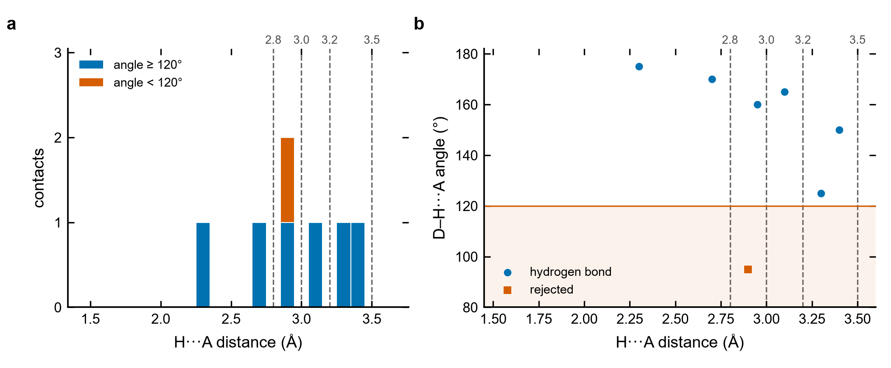

# Hydrogen bonds and short contacts in periodic structures

**Count the D–H···A hydrogen bonds of a POSCAR/CONTCAR — per donor group, under several distance
cutoffs, with the angle criterion, across periodic boundaries — for one structure or a whole folder of
them.**

<p align="center"></p>

## Why

In hybrid materials, molecular crystals and adsorbed molecules, the hydrogen bonds between organic
groups (NH3⁺, OH, H2O …) and their acceptors (halides, O, N) set how the molecules sit: their tilt,
their distance from an inorganic layer, which conformer is lowest. A structure file has no bonds,
only positions, so the hydrogen bonds have to be counted with geometric criteria, and the details
matter: an H that belongs to a C–H must not count, a short contact behind the N–H bond is not a
hydrogen bond, and in a small or skewed cell the contact may only exist with a periodic image.
Doing this by eye in VESTA does not scale to tens or hundreds of structures; this script does it the
same way for all of them.

## The geometric criteria

A contact D–H···A is a **hydrogen bond** when

| criterion | default | why |
|---|---|---|
| H···A distance ≤ cutoff | 2.8, 3.0, 3.2, 3.5 Å (all reported) | the useful cutoff depends on the acceptor: ~2.5 Å for O/N, ~3.0–3.2 Å for I (sum of the van der Waals radii of H and I ≈ 3.1–3.2 Å, Bondi 1964 / Rowland & Taylor 1996) |
| D–H···A angle (at H) ≥ θ | 120° | rejects contacts "behind" or beside the D–H bond (Steiner 2002; IUPAC 2011 recommends > 110°) |
| D···A distance ≤ cutoff | off (`--da-max`) | the classical criterion for O–H···O / N–H···O (≤ 3.5 Å, Jeffrey 1997) |

Reporting several cutoffs instead of one is deliberate: **a threshold is a convention**, and a count
that changes a lot between 3.0 and 3.2 Å is telling you that the contacts sit right at the threshold.

Hydrogen bonds are assigned as follows:

1. every H is attached to its **nearest heavy atom** (any periodic image); if that atom is a donor
   element (`--donors`, default N,O) within `--dh-max` (1.25 Å), the H is a donor H. H on carbon is
   ignored — unless you add C to the donors, to look at C–H···A contacts on purpose;
2. donor H are grouped by donor atom: one **donor group** per NH3, NH2, OH, H2O …;
3. every acceptor (`--acceptors`, default I,Br,Cl,O,N,F) within the largest cutoff of every donor H is
   found **in every periodic image**, not only the minimum image;
4. counts per cutoff (with and without the angle criterion), shortest H···A and its angle, shortest
   D···A, per group and per structure, plus a **soft count**
   Σ clip((d_max − d)/(d_max − d_min), 0, 1) over the hydrogen bonds (default d_min = 2.6, d_max = 3.5 Å):
   a contact at 2.6 Å or closer counts 1, one at 3.5 Å counts 0, so the number does not jump when a
   contact crosses a threshold.

Optionally, `--bridging-metal Pb` tags every acceptor by its number of metal neighbours within
`--metal-cutoff` (3.8 Å): **free** (0), **terminal** (1) or **bridging** (≥ 2), and splits the counts by
tag — for example, terminal (apical) versus bridging (equatorial) halides of a metal-halide layer.

## Quick start with the example data

[`examples/hbond_toy/`](../examples/hbond_toy) holds a synthetic cell, written by
[`examples/synthetic_hbonds.py`](../examples/synthetic_hbonds.py), with isolated fragments placed so
that every contact is known by construction: two methylammonium-like NH3 groups, a water molecule
and a methanol-like OH, with iodide, bromide and chloride acceptors, and Pb atoms that make some
iodides terminal and one bridging.

| group | contact | H···A (Å) | angle (°) | acceptor | note |
|---|---|---|---|---|---|
| 1 NH3 | H···I | 2.70 | 170 | terminal | |
| 1 NH3 | H···I | 2.95 | 160 | bridging | |
| 1 NH3 | H···I | 3.40 | 150 | terminal | |
| 2 NH3 | H···I | 3.10 | 165 | terminal | exists only across the *a* boundary |
| 2 NH3 | H···Br | 3.30 | 125 | free | |
| 3 OH2 | H···Cl | 2.30 | 175 | free | |
| 4 OH | H···I | 2.90 | 95 | terminal | short, but fails the angle |
| — C–H | H···I | 2.60 | 180 | free | on a methyl H: never counted |

```bash
python Hydrogen_Bonds/hbonds.py examples/hbond_toy/POSCAR --bridging-metal Pb
```

```text
examples/hbond_toy/POSCAR: 39 atoms, cell 16.000 16.000 16.000 Å, 90.0 90.0 90.0°
donors N,O (H within 1.25 Å), acceptors I,Br,Cl,O,N,F, hydrogen bond = H...A <= cutoff and D-H...A >= 120°
4 donor group(s), 9 donor H; 9 H on other atoms (e.g. C-H) ignored

                     hydrogen bonds with H...A <= cutoff (Å)
group   donor  label <=2.8 <=3.0 <=3.2 <=3.5  d_HA_min  angle  acceptor       tag  d_DA_min
    1     N18    NH3     1     2     2     3     2.700  170.0        I7  terminal     3.719
    2     N19    NH3     0     0     1     2     3.100  165.0       I10  terminal     3.981
    3     O20    OH2     1     1     1     1     2.300  175.0      Cl14      free     3.267
    4     O21     OH     0     0     0     0     2.900   95.0       I11  terminal     3.137

hydrogen bonds  <=2.8: 2  <=3.0: 3  <=3.2: 4  <=3.5: 6   (all H...A contacts: <=2.8: 2  <=3.0: 4  <=3.2: 5  <=3.5: 7)
  free acceptors      <=2.8: 1  <=3.0: 1  <=3.2: 1  <=3.5: 2
  terminal acceptors  <=2.8: 1  <=3.0: 1  <=3.2: 2  <=3.5: 3
  bridging acceptors  <=2.8: 0  <=3.0: 1  <=3.2: 1  <=3.5: 1
contacts <= 3.5 Å rejected by the angle: 1 (shortest 2.900 Å, 95.0°, O21-H36...I11)
shortest H...A 2.300 Å (175.0°), shortest hydrogen bond 2.300 Å; groups without hydrogen bond <= 3.5 Å: 1
soft count sum clip((3.5 - d)/(3.5 - 2.6), 0, 1): 3.278 (0.819 per group)
```

Every number is the designed one: 2 / 3 / 4 / 6 hydrogen bonds under the four cutoffs, 7 contacts
within 3.5 Å of which one (2.90 Å, 95°) is rejected by the angle, the C–H···I contact at 2.60 Å is
ignored, and group 2 finds its 3.10 Å contact through the periodic boundary.

### Many structures: one row each

```bash
python Hydrogen_Bonds/hbonds.py "examples/hbond_toy/POSCAR*" --summary-csv hbonds.csv --csv contacts.csv
```

```text
file                                groups <=2.8 <=3.0 <=3.2 <=3.5  d_HA_min  d_hb_min    soft
examples/hbond_toy/POSCAR                4     2     3     4     6     2.300     2.300   3.278
examples/hbond_toy/POSCAR_triclinic      4     2     3     4     6     2.300     2.300   3.278
contacts -> contacts.csv
summary -> hbonds.csv
```

`POSCAR_triclinic` holds the same fragments in a strongly skewed cell (γ ≈ 65°): the atoms wrap
differently, but the answer is identical — the periodic search does not depend on the cell shape.
A folder argument means its CONTCAR (or POSCAR), so `"runs/*"` analyses a whole campaign.
`--per-group` also prints the group table of every file.

## Reading the output

- **group table** — one line per donor group: hydrogen bonds under each cutoff, the shortest H···A
  contact *of any angle* with its angle and acceptor (a short contact with a bad angle shows up here,
  as for group 4), and the shortest D···A to any acceptor within `--da-search` (5 Å).
- **hydrogen bonds / all H···A contacts** — totals of the cell with and without the angle criterion;
  the difference is the number of rejected contacts.
- **groups without hydrogen bond** — donor groups with no hydrogen bond under the largest cutoff
  (for example, a cation that has lifted off a surface).
- **CSV files**: `--csv` writes every contact (donor, H, acceptor, 1-based indices, d(H···A), angle,
  d(D···A), metal tag, `hbond` True/False) — the table to filter yourself with other criteria;
  `--groups-csv` the group table; `--summary-csv` one row per structure with `n_HA_<c>` (all contacts),
  `n_hb_<c>` (hydrogen bonds), `n_hb_<c>_per_group`, the tag split `n_hb_<c>_terminal/bridging/free`,
  shortest distances and the soft count.
- `--plot fig.png` draws the figure above: the H···A histogram with the cutoffs (a) and the angle
  against the distance (b), for all files given.

Exit code 0 if every file was read, 1 otherwise.

## Options

| Option | Default | Meaning |
|---|---|---|
| `--donors` | `N,O` | donor elements (add `C` for C–H···A contacts) |
| `--acceptors` | `I,Br,Cl,O,N,F` | acceptor elements |
| `--dh-max` | `1.25` | max distance between an H and its donor (Å) |
| `--min-h` | `1` | min number of H for a donor group (`3`: NH3/NH3⁺ only) |
| `--cutoffs` | `2.8,3.0,3.2,3.5` | H···A cutoffs (Å) |
| `--angle` | `120` | min D–H···A angle (°) |
| `--da-max` | off | max D···A distance (Å) |
| `--da-search` | `5.0` | search radius for the shortest D···A per group (Å) |
| `--bridging-metal` | off | metal element(s); tag acceptors free/terminal/bridging |
| `--metal-cutoff` | `3.8` | metal–acceptor bond cutoff for the tags (Å) |
| `--soft` | `2.6,3.5` | d_min,d_max of the soft count (Å) |
| `--per-group` | — | group table for every file in batch mode |
| `--csv`, `--groups-csv`, `--summary-csv` | — | contact, group and per-structure tables |
| `--plot` | — | PNG figure (needs matplotlib) |

Input: VASP 5 POSCAR/CONTCAR (Direct or Cartesian, selective dynamics, negative scale = volume) or the
last frame of an XDATCAR; folders; glob patterns (expanded by the script, also on Windows).

## Pitfalls

- **Minimum image is not enough in small or skewed cells.** Rounding the fractional difference
  finds the nearest image only for distances below half the smallest interplanar spacing. A
  one-octahedron perovskite cell (a ≈ 6.3 Å) with a 3.5 Å cutoff already breaks that rule, and in a
  skewed cell an acceptor can touch the same H through two images. This script searches every image
  within the cutoff (the test-suite checks it against a brute-force supercell).
- **H assignment.** An H is given to its nearest heavy atom, so a methyl H close to an N is not
  mistaken for an N–H. If a proton has really moved (a strong hydrogen bond, a proton transfer), its
  nearest heavy atom may be the acceptor: check the `n_unbonded_H` and `n_other_H` counts and the
  D–H lengths, and adjust `--dh-max`.
- **Thresholds are conventions.** There is no sharp border between a hydrogen bond and a van der
  Waals contact; report counts under several cutoffs (or the soft count) and check that a
  conclusion does not depend on one of them.
- **Element-specific cutoffs.** One H···A cutoff for I and O at the same time is a compromise; for
  mixed acceptors run the script once per acceptor (`--acceptors I`, then `--acceptors O`) with
  cutoffs suited to each.
- **Geometry, not energy.** A geometric hydrogen bond is a necessary condition, not a measure of its
  strength; for that, look at the electron density (QTAIM, NCI) or at energies.
- **Frozen atoms.** If part of the structure was fixed during the relaxation, its contacts reflect the
  starting geometry: check the constraints with [`Selective_Dynamics`](../Selective_Dynamics).

## References

- G. A. Jeffrey, *An Introduction to Hydrogen Bonding*, Oxford University Press (1997).
- T. Steiner, "The hydrogen bond in the solid state", *Angew. Chem. Int. Ed.* **41**, 48 (2002).
- E. Arunan *et al.*, "Definition of the hydrogen bond (IUPAC Recommendations 2011)",
  *Pure Appl. Chem.* **83**, 1637 (2011).
- G. R. Desiraju and T. Steiner, *The Weak Hydrogen Bond in Structural Chemistry and Biology*,
  Oxford University Press (1999).
- A. Bondi, "van der Waals volumes and radii", *J. Phys. Chem.* **68**, 441 (1964);
  R. S. Rowland and R. Taylor, *J. Phys. Chem.* **100**, 7384 (1996).
