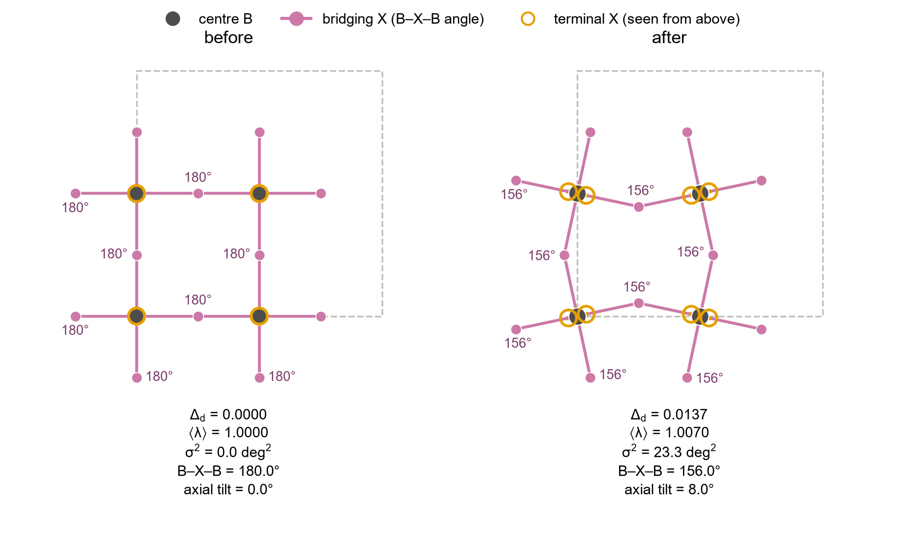

# Octahedral distortion: bonds, distortion indices and tilts of BX6 octahedra

**Measure every metal–ligand octahedron of a POSCAR/CONTCAR — bond lengths, Baur distortion index,
quadratic elongation, bond-angle variance, B–X–B bridging angles and axial tilts — for one structure,
a whole campaign, or before and after a relaxation.**

<p align="center"></p>

## Why

In halide and oxide perovskites — 3D, and layered Ruddlesden–Popper or Dion–Jacobson phases — the
band edges are made of the B–X bonds of corner-sharing BX6 octahedra (B = Pb, Sn, Ge …; X = I, Br,
Cl, O). The gap and the band widths follow the framework: bending the B–X–B bridge narrows the bands,
elongating the octahedra splits them. Before you explain a change of band gap or band alignment, you
want to know *what the framework did*. "It relaxed" is not an answer; "the bridging angle closed by
6° and the axial bond tilted by 3°" is.

Doing this by hand in a viewer fails on exactly the structures that matter: slabs whose ligands wrap
across the cell boundary, small cells in which a ligand bonds to the *same* centre through two
periodic images, and triclinic cells where the naive "nearest image" is the wrong one.

## Definitions

For each centre B the six ligands within the cutoff give the bond lengths $d_i$, their mean
$\langle d\rangle$, and

| Quantity | Formula | Ideal octahedron |
|---|---|---|
| Baur bond-length distortion index | $\Delta_d = \dfrac{1}{6}\sum_{i=1}^{6}\dfrac{\lvert d_i-\langle d\rangle\rvert}{\langle d\rangle}$ | 0 |
| quadratic elongation | $\langle\lambda\rangle = \dfrac{1}{6}\sum_{i=1}^{6}\left(\dfrac{d_i}{l_0}\right)^2$ | 1 |
| bond-angle variance (deg²) | $\sigma^2 = \dfrac{1}{11}\sum_{j=1}^{12}(\theta_j-90^\circ)^2$ | 0 |

- $l_0$ is the centre–vertex distance of the **regular** octahedron with the same volume $V$:
  $V = \tfrac{4}{3}l_0^3$. The volume is computed exactly from the eight triangular faces, so it is
  correct even when B sits off the middle of its octahedron.
- $\theta_j$ are the 12 *cis* X–B–X angles (the three *trans* pairs, the most opposite ligands, are
  left out).
- $\Delta_d$ sees only bond lengths; $\langle\lambda\rangle$ sees lengths and angles; $\sigma^2$ sees
  angles only. Report at least $\Delta_d$ and $\sigma^2$: they are independent.

For **layered sheets** (n = 1) each ligand is classified by the number of centres it is bonded to:

- **bridging** (two centres) = equatorial. The **B–X–B angle** at the ligand is 180° for flat,
  unrotated corner-sharing octahedra; rotations and tilts of neighbouring octahedra close it.
- **terminal** (one centre) = axial. The **axial tilt** is the angle between the B–X bond and the
  sheet normal $\hat n$ (0° = upright).
- **area per centre** $= \lvert\mathbf a\times\mathbf b\rvert\,N_\text{sheets}/N_B$, the in-plane
  area of one octahedron (it shrinks when the octahedra rotate).

The sheet normal is $\hat n \propto \mathbf a\times\mathbf b$ by default (layers stacked along *c*);
`--normal a` uses $\mathbf b\times\mathbf c$, `--normal b` uses $\mathbf c\times\mathbf a$, and
`--normal x,y,z` any Cartesian direction. In a 3D perovskite every ligand is bridging and the tool says
so; the axial quantities are then left empty.

## Quick start with the example data

The synthetic sheets in [`examples/`](../examples) (written by
[`examples/synthetic_octahedra.py`](../examples/synthetic_octahedra.py)) have closed-form answers:
a 2 × 2 cell of corner-sharing PbI6 octahedra, with small cations in the hollows, in which the
octahedra rotate by ±12° about the normal (checkerboard), the axial bond is elongated
(3.20 / 3.30 Å) and the axial axis leans by 8°. Therefore B–X–B = 180° − 2 × 12° = 156°,
$\Delta_d = \tfrac{4}{9}(3.30-3.20)/\langle d\rangle = 0.01375$ and
$\sigma^2 = 4\times 8^2/11 = 23.27$ deg².

```bash
python Octahedral_Distortion/octahedra.py examples/octahedra_distorted/POSCAR
```

```text
examples/octahedra_distorted/POSCAR
  centres Pb4, ligands I, cutoff 4.21 Å (auto, largest gap 3.30-5.12 Å)
  octahedra: 4 of 4 with 6 ligands; 8 bridging + 8 terminal ligands -> layered sheet (terminal ligands present)
  sheets per cell 1, normal (0.000, 0.000, 1.000)
  quantity                             mean       min       max
  B-X bond length (Å)                3.2333    3.2000    3.3000
  Baur distortion index Delta_d     0.01375   0.01375   0.01375
  quadratic elongation <lambda>     1.00697   1.00697   1.00697
  bond-angle variance (deg^2)        23.273    23.273    23.273
  octahedron volume (Å^3)            44.618    44.618    44.618
  equatorial (bridging) B-X (Å)      3.2000    3.2000    3.2000
  axial (terminal) B-X (Å)           3.3000    3.3000    3.3000
  B-X-B bridging angle (deg)         156.00    156.00    156.00
  axial tilt from normal (deg)         8.00      8.00      8.00
  area per centre (Å^2)              39.189
```

Every number is the one built into the structure. The other three examples are the ideal sheet
(Δ_d = 0, ⟨λ⟩ = 1, σ² = 0, B–X–B = 180°, tilt 0°), the distorted sheet described by a very skewed
triclinic cell (γ ≈ 27°), and the distorted sheet as a slab with ~19 Å of vacuum and atoms wrapped
across the cell boundary. The last two must — and do — give identical numbers:

```bash
python Octahedral_Distortion/octahedra.py "examples/octahedra_*" --csv octahedra.csv
```

```text
structure                                 oct   <d> Å  Delta_d  <lambda>   sigma2   B-X-B   tilt
examples/octahedra_distorted/POSCAR         4  3.2333  0.01375   1.00697   23.273  156.00   8.00
examples/octahedra_ideal/POSCAR             4  3.1500  0.00000   1.00000    0.000  180.00   0.00
examples/octahedra_skewed/POSCAR            4  3.2333  0.01375   1.00697   23.273  156.00   8.00
examples/octahedra_slab/POSCAR              4  3.2333  0.01375   1.00697   23.273  156.00   8.00
csv -> octahedra.csv
```

## Before and after a relaxation

`--compare BEFORE AFTER` prints the change of every quantity, and the octahedra with the largest
change (matched by atom index, so use the POSCAR and the CONTCAR of the same run):

```bash
python Octahedral_Distortion/octahedra.py --compare examples/octahedra_ideal/POSCAR \
       examples/octahedra_distorted/POSCAR --plot octahedra.png
```

```text
before: examples/octahedra_ideal/POSCAR
after : examples/octahedra_distorted/POSCAR
  quantity (mean)                    before     after    change
  B-X bond length (Å)                3.1500    3.2333   +0.0833
  Baur distortion index Delta_d     0.00000   0.01375  +0.01375
  quadratic elongation <lambda>     1.00000   1.00697  +0.00697
  bond-angle variance (deg^2)         0.000    23.273   +23.273
  octahedron volume (Å^3)            41.674    44.618    +2.943
  equatorial (bridging) B-X (Å)      3.1500    3.2000   +0.0500
  axial (terminal) B-X (Å)           3.1500    3.3000   +0.1500
  B-X-B bridging angle (deg)         180.00    156.00    -24.00
  axial tilt from normal (deg)         0.00      8.00     +8.00
  area per centre (Å^2)              39.690    39.189    -0.501
  per octahedron (4 matched by atom index), largest |change|:
    <d> (Å)             +0.08333  (atom 2 Pb)
    Delta_d             +0.01375  (atom 4 Pb)
    <lambda>            +0.00697  (atom 1 Pb)
    sigma^2 (deg^2)    +23.27273  (atom 2 Pb)
    B-X-B (deg)        -24.00000  (atom 3 Pb)
    tilt (deg)          +8.00000  (atom 1 Pb)
plot -> octahedra.png
```

The plot (figure at the top) is a top view of the first sheet of each structure: centres, bridging
ligands with their B–X–B angle, and terminal ligands as rings (a ring off its centre = a tilted axial
bond). With `--csv` the compare mode writes one row per octahedron with `_before`, `_after` and
`_change` columns.

## Step by step

1. **Choose the atoms.** `--centers` and `--ligands` take comma-separated elements; only those present
   are used (defaults `Pb,Sn,Ge` and `I,Br,Cl,O`, so mixed-halide and mixed-metal cells work as they are).
   Everything else — organic cations, A-site cations, water — is ignored.
2. **Check the cutoff line.** By default the cutoff is put in the middle of the largest gap of the
   B–X distances between the shortest one and 1.6 × that value; the header prints the gap. The second
   coordination shell of a perovskite is ≳ 1.5 × the bond length away, so the gap is wide. If the
   distances are continuous (no gap of at least 10 % of the shortest bond) the cutoff falls back to
   1.3 × the shortest bond and the header says so.
3. **Check the octahedra line.** `4 of 4 with 6 ligands` is what you want. A centre with 5 or 7
   ligands gets a warning and empty distortion indices: set `--cutoff` by hand, or look at the
   structure — it may really be a broken octahedron.
4. **Read the layered quantities** only for layered sheets (the header says *layered sheet*), with the
   normal printed on the fourth line pointing along the stacking direction.

## How to read the numbers

- The indices are most useful as *comparisons* — between structures of a series, between the two
  sides of a slab, or before and after a relaxation — computed with the same cutoff. A growing
  $\Delta_d$ means the centre moves off the middle of its octahedron or one bond direction elongates
  (lone-pair activity, a ligand pulled by hydrogen bonds).
- $\langle\lambda\rangle$ grows with both bond-length and angular distortion (Robinson et al. 1971 found it
  nearly linear in $\sigma^2$ for angular distortions); a larger $\langle\lambda\rangle - 1$ with a
  small $\sigma^2$ points to a bond-length distortion.
- The B–X–B angle is the descriptor most directly tied to the band gap in corner-sharing frameworks:
  the smaller the angle, the weaker the B–X–B overlap and the larger the gap.
- `min`/`max` columns reveal inequivalent octahedra (e.g. the two sides of a slab); the CSV gives each.

## Options

| Option | Default | Meaning |
|---|---|---|
| `structures` | — | POSCAR/CONTCAR files, folders (→ CONTCAR, else POSCAR) or glob patterns |
| `--compare BEFORE AFTER` | — | change of every quantity between two structures |
| `--centers` | `Pb,Sn,Ge` | centre elements |
| `--ligands` | `I,Br,Cl,O` | ligand elements |
| `--cutoff` | automatic | B–X bond cutoff (Å) |
| `--normal` | `c` | sheet normal: `c` (= a × b), `a` (= b × c), `b` (= c × a) or `x,y,z` |
| `--csv FILE` | — | one row per octahedron (compare mode: before / after / change) |
| `--plot FILE` | — | top view of the sheet(s) with the B–X–B angles (needs matplotlib) |
| `--verbose` | — | full summary of every structure in batch mode |

Exit code 0 on success, 1 if a structure cannot be read or has no centre/ligand atom.

## Pitfalls

- **Relaxations with frozen atoms.** If B and X were fixed by selective dynamics, the octahedra in the
  CONTCAR are the ones you put in. Check with [`Selective_Dynamics`](../Selective_Dynamics) before
  interpreting a "no change" result.
- **Wrong normal.** The tilt and the area assume the sheets lie in the a–b plane. If your stacking axis
  is *a* or *b*, pass `--normal a` / `--normal b`; for a sheet that is not parallel to any cell face,
  pass the Cartesian normal (the area per centre is then left empty).
- **n > 1 layers.** In an n = 2, 3 … slab the inner ligands are bridging along the normal too, so the
  "equatorial" average mixes in-plane and out-of-plane bridges. The per-octahedron CSV and the
  `--normal` tilt of the terminal bonds stay meaningful.
- **Edge- or face-sharing frameworks.** The bridging/terminal classification counts centres per
  ligand; ligands shared by three or more centres are reported and not counted as bridging.
- **Strongly distorted units** (e.g. close to a trigonal prism) may have no clean
  trans pairs; ⟨λ⟩ and σ² are then left empty and a warning is printed, while $\Delta_d$ is still given.

## References

- W. H. Baur, *The geometry of polyhedral distortions. Predictive relationships for the phosphate
  group*, Acta Crystallogr. B **30**, 1195 (1974) — the bond-length distortion index.
- K. Robinson, G. V. Gibbs, P. H. Ribbe, *Quadratic elongation: a quantitative measure of distortion
  in coordination polyhedra*, Science **172**, 567 (1971) — quadratic elongation and bond-angle variance.
- K. Momma, F. Izumi, *VESTA 3*, J. Appl. Crystallogr. **44**, 1272 (2011) — the same three indices,
  for a visual cross-check.
- J. L. Knutson, J. D. Martin, D. B. Mitzi, *Tuning the band gap in hybrid tin iodide perovskite
  semiconductors using structural templating*, Inorg. Chem. **44**, 4699 (2005) — B–X–B angle and band gap
  in layered perovskites.
- M. R. Filip, G. E. Eperon, H. J. Snaith, F. Giustino, *Steric engineering of metal-halide perovskites
  with tunable optical band gaps*, Nat. Commun. **5**, 5757 (2014).
- L. Mao, C. C. Stoumpos, M. G. Kanatzidis, *Two-dimensional hybrid halide perovskites: principles and
  promises*, J. Am. Chem. Soc. **141**, 1171 (2019) — layered (RP, DJ) structures and their distortions.

## Related tools

- [`Selective_Dynamics`](../Selective_Dynamics) — were the octahedra allowed to move?
- [`Run_Diagnostics`](../Run_Diagnostics) — did the relaxation converge?
- [`Band_Alignment_Vacuum`](../Band_Alignment_Vacuum) — the band edges the framework produces.
