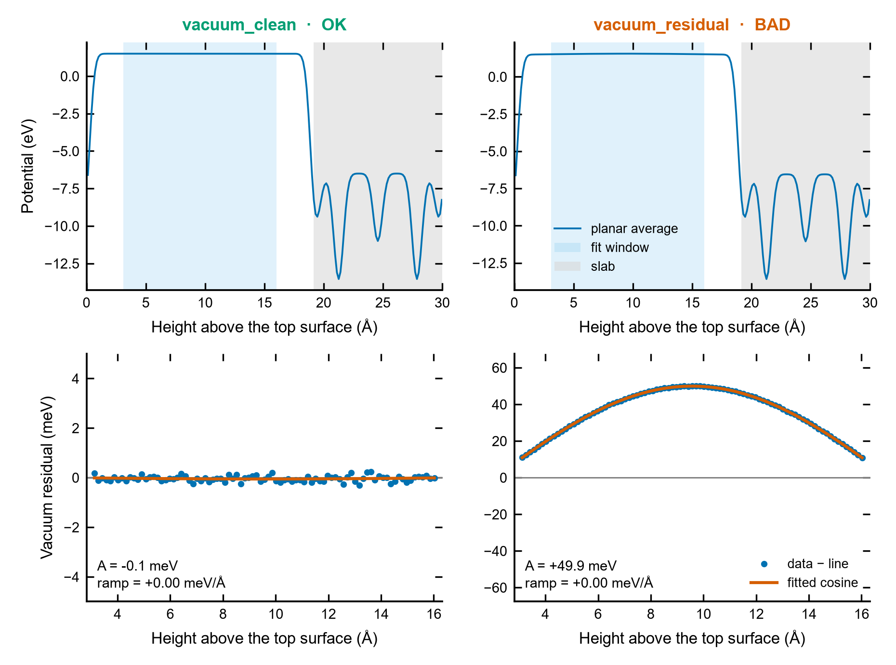

# Vacuum potential check

**Is the electrostatic potential in the vacuum of my slab converged and clean enough to be the
reference for IPs, EAs and work functions? One number per run, a verdict, and a figure.**

<p align="center"></p>

## Why

Every vacuum-referenced number — ionization potential, electron affinity, work function, band
offsets between separate slab calculations — is measured from the plateau of the planar-averaged
potential in the vacuum. The usual checks (is there a plateau? are the two sides equal?) catch a
too-thin vacuum or an uncorrected dipole, but not a subtler failure: a **smooth, long-wavelength
error of the Hartree potential** left by an SCF that has not fully converged. It bends the whole
cell by a few tens of meV, the total energy hardly notices, the plateau still *looks* flat on the
eV scale of a potential plot — and every level referenced to it moves.

`vacuum_check.py` looks at the vacuum on the meV scale, separates what physics allows there from
what it does not, and says whether the vacuum can be trusted as a reference. It runs on one LOCPOT
or on a whole campaign.

## The physics in five lines

Between two slab images there is no charge, so Poisson's equation, `d²V/dz² = −ρ/ε₀ = 0`, allows only
a **straight line** in the vacuum:

- a **constant** — the vacuum level;
- a **ramp** (uniform field) if the slab carries a dipole and no correction is applied;
- a **step** where the dipole correction (`IDIPOL`/`LDIPOL`) puts its compensating dipole layer.

Anything else is an error of the calculation. In the charge-density mixing the slowest modes are the
longest wavelengths (their Hartree response grows as 1/G², the "charge sloshing" that Kerker
preconditioning is designed to damp). Along the normal of a slab the longest wavelength is the cell
length L itself, so an unconverged component appears as

    V(z) = c0 + c1 (z − z_mid) [+ D H(z − z_step)] + A cos(2π (z − z_mid) / L)

which is what the tool fits inside the vacuum (z_mid = middle of the vacuum gap, H = step function).
A clean vacuum gives **A = 0** to within the numerical noise. The same error potential also acts
inside the slab, where a cosine centred on the vacuum has the opposite sign, so vacuum-referenced
eigenvalues can be off by up to about 2A.

## Setting up the VASP run

```
LVHAR  = .TRUE.     ! LOCPOT = ionic + Hartree potential: the right quantity for a vacuum level
EDIFF  = 1E-6       ! or tighter for meV-level vacuum references
IDIPOL = 3          ! only for asymmetric slabs (normal along c) ...
LDIPOL = .TRUE.     ! ... together with the potential correction
```

`LVTOT = .TRUE.` writes the total local potential, which also contains exchange–correlation; it
decays slowly into the vacuum, and the tool warns when the INCAR says so. The tool reads the INCAR
next to each LOCPOT and prints `ALGO, EDIFF, NELM, IMIX, AMIX, BMIX, AMIN, IDIPOL, LDIPOL, LVHAR, LVTOT`
in the CSV (a `-` means the tag is absent, i.e. the VASP default).

## Quick start with the example data

The four folders `examples/vacuum_*` hold LOCPOTs of the same toy slab (c = 30 Å, 19 Å of vacuum)
whose vacuum has a known defect (written by [`examples/synthetic_vacuum.py`](../examples/synthetic_vacuum.py)):
nothing, a 50 meV cosine (in a four-block, non-collinear LOCPOT), a 10 meV/Å dipole ramp, and a
0.30 eV dipole-correction step.

```bash
python Vacuum_Potential_Check/vacuum_check.py "examples/vacuum_*" --csv vacuum.csv --plot vacuum.png
```

```
run                       gap window   A_cos  A_free    ramp    step   rms   EDIFF  AMIX   BMIX LDIPOL  verdict
                            Å      Å     meV     meV   meV/Å      eV   meV
vacuum_clean            19.14  12.90    -0.1     0.1    0.00   0.000   0.1    1E-6     -      -      -  OK
vacuum_dipole_step      19.14  12.90    -0.1     0.2    0.01   0.300   0.1    1E-6     -      - .TRUE.  OK
vacuum_ramp             19.14  12.90    -0.1     0.1   10.00   0.000   0.1    1E-6     -      -      -  WARN
vacuum_residual         19.14  12.90    49.9    49.9    0.00   0.000   0.1    1E-3     -      -      -  BAD
[WARN] vacuum_ramp: uniform field in the vacuum (+10.00 meV/Å): an uncorrected slab dipole, so the vacuum level is not defined; use IDIPOL = 3 with LDIPOL = .TRUE. (or a symmetric slab)
[BAD] vacuum_residual: long-wavelength residual in the vacuum (cosine amplitude +49.9 meV): the electrostatic potential is not converged; tighten EDIFF, restart from the converged density, check the mixing (AMIX, BMIX, AMIN) and compare two runs
4 runs: 2 OK, 1 WARN, 1 BAD (thresholds: cosine 5/20 meV, ramp 2 meV/Å, rms 5 meV)
4 records -> vacuum.csv
figure -> vacuum.png
```

Every injected feature is recovered: A = 49.9 meV for the 50 meV cosine (0.5 meV of random noise was
added to every grid point), a 10.00 meV/Å ramp with no leakage into the cosine, a 0.300 eV step with a flat
vacuum on both sides. The figure at the top is
`vacuum_check.py examples/vacuum_clean examples/vacuum_residual --plot vacuum_check.png`.

The arguments can be LOCPOT files (also `LOCPOT.gz`), run folders containing one, or glob patterns;
on Windows the patterns are expanded by the script itself.

## Step by step

1. **Planar average, streaming.** The LOCPOT is read chunk by chunk and summed plane by plane, so the
   memory used does not grow with the grid: a LOCPOT of several GB is fine. Only the first data block is
   used (non-collinear runs write four; the first is the potential).
2. **Vacuum gap.** The largest atom-free gap along the normal (`--axis`, default c; tilted cells are
   handled through the interplanar distance). Planes closer than `--margin` Å (default 3) to any atom
   are discarded: the electron density of the surface still spills out there.
3. **Step.** If two neighbouring planes differ by more than `--step-min` (20 meV) beyond the local
   slope, a step term D is added at that position and ±`--step-exclude` Å around it are left out.
4. **Fit.** Linear least squares of the model above. The cosine phase is fixed at the middle of the
   vacuum (an error symmetric about the slab is even there). A free-phase fit (cosine + sine) is
   reported as `A_free`; on a slab with a ramp its sine part is nearly indistinguishable from the
   ramp over a window shorter than L, so `A_cos` is the headline number.
5. **Verdict.** BAD if |A| ≥ `--bad` (20 meV), WARN if |A| ≥ `--warn` (5 meV), a |ramp| ≥ `--ramp-warn`
   (2 meV/Å), an RMS residual ≥ `--rms-warn` (5 meV), a step without `LDIPOL` in the INCAR, an
   `LVTOT` potential, or a fit window shorter than 5 Å. Each WARN/BAD is printed with its reason.

## Reading the figure

Top: the whole planar average, with the fit window (blue) and the slab (grey), plotted from the
outermost atom of the top surface across the vacuum. Bottom: what is left in the vacuum after the
straight line (and step) are removed, in meV, with the fitted cosine.

| Bottom panel | Meaning |
|---|---|
| points scattered around 0 within a fraction of a meV | clean vacuum; use it as the reference |
| a smooth arch (or trough) across the whole window | long-wavelength residual: the SCF is not converged in the G → 0 sense |
| a residual that is not an arch: wiggles near the window ends | `--margin` too small, or the vacuum too thin |
| ramp ≠ 0 in the text | an uncorrected dipole: the two sides have different vacuum levels |

## What to do with a WARN or BAD

- **Cosine residual.** Tighten `EDIFF` (1E-6 or below), restart from the converged `WAVECAR`/`CHGCAR`
  and let the SCF run until the density, not only the energy, has settled. Look at the mixing:
  `AMIX`, `BMIX` (Kerker wave vector, which governs the long wavelengths), `AMIN`, `IMIX`. The most
  convincing check is to **compare two runs** of the same slab — tighter EDIFF, different mixing —
  and verify that both the cosine and the vacuum-referenced levels stop changing.
- **Ramp.** Add `IDIPOL = 3` and `LDIPOL = .TRUE.` (with `DIPOL` at the slab centre if the slab is not
  near the middle of the cell), or build a symmetric slab.
- **Step without LDIPOL, large RMS.** Look at the plot: a charged cell, a molecule that drifted into
  the vacuum, or a LOCPOT written with `LVTOT`.

## Options

| Option | Meaning |
|---|---|
| `paths` | LOCPOT files, run folders or glob patterns (default: current folder) |
| `--axis 0/1/2` | surface normal along a, b or c (default c) |
| `--margin 3.0` | distance (Å) from every atom excluded from the fit |
| `--step auto/on/off` | fit a dipole-correction step: detect it (default), always, never |
| `--step-min 0.02` | smallest jump (eV) between two planes taken as a step |
| `--step-exclude 0.5` | half width (Å) left out of the fit around the step |
| `--side-width 1.0` | width (Å) of each end of the window for the two-side difference |
| `--warn 5`, `--bad 20` | cosine amplitude thresholds (meV) |
| `--ramp-warn 2`, `--rms-warn 5` | ramp (meV/Å) and RMS residual (meV) thresholds |
| `--jobs N` | parallel processes for many LOCPOTs |
| `--csv FILE` | one row per run (columns below) |
| `--plot FILE` | figure of the fit (PNG/PDF/SVG), first six runs |
| `--quiet` | table only, no reasons |

Exit code: 0 when every path was analysed (whatever the verdicts), 2 when some failed, 1 when none
could be read.

## Output columns

| Column | Meaning |
|---|---|
| `cos_amp_meV` | A, cosine amplitude with the phase fixed at mid-vacuum (signed: + = the vacuum bulges up) |
| `cos_amp_free_meV` | amplitude of a free-phase cosine (cosine + sine) |
| `bow_meV` | how much the cosine bends the potential inside the fit window, \|A\|(1 − cos(π w/L)) |
| `ramp_meV_per_A` | dV/dz in the vacuum |
| `step_eV` | dipole-correction step, side above the top surface minus side below the bottom surface |
| `two_side_diff_eV`, `V_upper_eV`, `V_lower_eV` | mean potential over the first and last `--side-width` Å of the window and their difference |
| `V_vac_mean_eV` | mean potential in the window (the vacuum level, if the verdict is OK) |
| `rms_meV`, `rms_linear_meV` | RMS residual of the full fit and of the straight line alone |
| `L_A`, `vac_gap_A`, `window_A`, `n_points` | cell length along the normal, vacuum gap, fit window, planes in the fit |
| `ALGO` … `LVTOT` | INCAR tags found next to the LOCPOT |
| `verdict`, `reasons` | OK / WARN / BAD and why |

## Good practice and pitfalls

- **Look at meV, not eV.** A 50 meV arch is invisible on a potential plot spanning 15 eV; that is why
  the bottom panel shows the residual only.
- **The window must be long enough.** The cosine is identified by the curvature it gives the
  vacuum; over a window much shorter than L that curvature is small. With less than ~5 Å of fit window
  the amplitude is poorly determined (the tool warns). Prefer ≥ 15 Å of vacuum.
- **Do not lower `--margin` to rescue a thin vacuum.** Near the surface the density tail is real
  charge, and the straight-line model no longer holds.
- **An OK verdict is necessary, not sufficient.** A converged vacuum says nothing about the
  convergence of the slab thickness, k-points or functional.
- **Comparing calculations.** Before comparing vacuum-referenced levels from different runs, check
  the vacuum of every one of them: the comparison is only as good as the worst reference.

## References

- VASP wiki: [LVHAR](https://www.vasp.at/wiki/index.php/LVHAR), [LOCPOT](https://www.vasp.at/wiki/index.php/LOCPOT),
  [IDIPOL](https://www.vasp.at/wiki/index.php/IDIPOL), [LDIPOL](https://www.vasp.at/wiki/index.php/LDIPOL),
  [DIPOL](https://www.vasp.at/wiki/index.php/DIPOL), [AMIX](https://www.vasp.at/wiki/index.php/AMIX),
  [BMIX](https://www.vasp.at/wiki/index.php/BMIX), [AMIN](https://www.vasp.at/wiki/index.php/AMIN),
  [IMIX](https://www.vasp.at/wiki/index.php/IMIX), [EDIFF](https://www.vasp.at/wiki/index.php/EDIFF).
- G. P. Kerker, *Phys. Rev. B* **23**, 3082 (1981) — preconditioning of the long-wavelength charge sloshing.
- G. Kresse and J. Furthmüller, *Comput. Mater. Sci.* **6**, 15 (1996) — density mixing in VASP.
- J. Neugebauer and M. Scheffler, *Phys. Rev. B* **46**, 16067 (1992); L. Bengtsson, *Phys. Rev. B*
  **59**, 12301 (1999) — the dipole correction for slabs.
- See also [`LOCPOT_Planar_Average`](../LOCPOT_Planar_Average) (profiles, vacuum level, work function)
  and [`Band_Alignment_Vacuum`](../Band_Alignment_Vacuum) (band edges on the vacuum scale).
